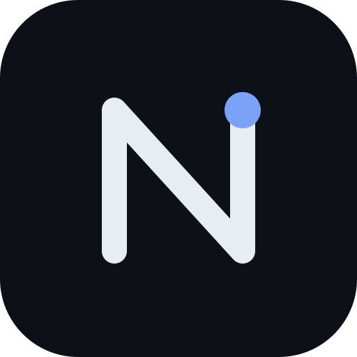

# Nomen

自由的账号星系。

每个网站都可以有自己的名字、自己的内容和自己的空间，但不必各自建立一套账号体系。

Nomen 是一个自由、开放、可自托管的账号系统。 它将账号、身份认证与授权集中在一个地方，让不同的网站和应用通过统一的身份体系彼此连接。

部署一份 Nomen，让你的多个站点共享同一套账号。用户只需要一个身份，就可以在不同的服务之间自由穿行。

账号属于用户，数据由部署者管理，连接由站点决定。

这就是 Nomen 想做的事。

## 官方实例

- [nomen.caellab.com](https://nomen.caellab.com/)
- [id.caellab.com](https://id.caellab.com/)

两个实例运行同一套 Nomen 代码。官方实例还提供站内文档，安装后可通过 `/w` 访问（由 pages 插件提供）。

---

## 一个账号，连接多个站点

Nomen 负责账号与身份，接入的站点负责自己的业务。双方通过 OAuth 2.0 建立连接，不需要每个站点重复处理注册、登录和密码管理。

```text
                 Nomen
              统一账号与身份
                    │
          ┌─────────┼─────────┐
          │         │         │
        站点 A     站点 B     应用 C
          │         │         │
          └─────────┼─────────┘
                    │
                同一身份
```

站点可以独立运行，也可以选择接入同一个 Nomen 实例。是否共享账号，由站点管理者决定。

## 功能

### 账号与身份

- 一个用户名，最多绑定 5 个邮箱，其中一个为首选邮箱。
- 头像、语言和皮肤偏好。
- 密码登录、邮箱验证码登录。
- Passkey（WebAuthn）无密码认证。
- 第三方登录：GitHub、Google、Microsoft、CaelLabID，也支持标准 OAuth 2.0 提供方。

### 账号安全

- TOTP 动态验证码。
- 恢复码。
- 邮件验证码二步验证。
- 账号恢复申诉、管理员审核与一次性恢复链接。
- 凭据重设与账号安全管理。

### OAuth 2.0

- OAuth 2.0 授权码流程。
- PKCE，仅接受 S256。
- `/api/userinfo` 用户信息接口，返回 `sub`、`username`、昵称和头像。

### 家庭与未成年人保护（可选）

- 家长同意机制与家长邮箱。
- 家长可以重置密码、临时锁定账号。
- 家长权限受到限制，不能查看孩子的其他个人资料。
- 可根据注册时选择的国家或地区，按照当地同意年龄规则进行处理。

### 管理与开发

- 活动日志：按类型、执行者和目标筛选，支持字段对照及 CSV 导出。
- 站内通知。
- 开发者开放平台。
- Vue SPA 管理后台，包含用户、应用、接入点、恢复工单、日志和插件选项卡。
- 可在后台修改首页标题、按钮，也可以指定一个站内页面作为首页。

### 扩展与界面

- 25 种界面语言，默认语言及语言切换权限由站长决定。
- 站内文档。
- 可替换的皮肤，包括纯 PHP 实现的 `nomen-ssr`。
- 可插拔的功能模块。

部分功能为可选项，默认关闭。可以在安装时选择，也可以在安装后修改 `config/installed.php`。具体配置见 [INSTALL.md](INSTALL.md)。

---

## 部署

### 环境要求

| 组件 | 要求 |
|---|---|
| PHP | 8.1+ |
| MySQL | 8+ |
| MariaDB | 10.6+ |
| SQLite | 3.35+ |
| Composer | 必需 |
| Redis | 可选，用于限流和多设备会话踢出 |
| Node.js | 18+，仅修改前端时需要 |

Redis 连接失败时会自动降级，不影响基础运行。

### 安装

从 [Nomen 发布包](https://dl.caellab.com/file/nomen/) 下载对应版本，解压到站点目录，并将 Web Root 指向 `public/`。

首次访问站点会进入安装向导。

也可以使用命令行安装：

```bash
php bin/nomen install
```

Nginx 需要配置伪静态：

```nginx
location / {
    try_files $uri $uri/ /index.php$is_args$args;
}
```

如果缺少这条规则，通常只有首页可以正常访问。

数据库准备、前端构建、邮件、GeoIP 和故障排查，请参阅 [INSTALL.md](INSTALL.md)。

### 升级

下载新版本覆盖文件，保留以下内容：

- `config/installed.php`
- `.env`
- `data/`
- 上传目录

如果使用 Git 部署，也可以通过 `git pull` 更新。

更新代码后执行：

```bash
composer install --no-dev
php bin/nomen upgrade
```

升级命令会执行核心数据库迁移和插件迁移。

备份要求及升级注意事项见 [升级文档](INSTALL.md#升级)。

---

## 开发与扩展

Nomen 将功能与外观分开管理。你可以扩展系统功能，也可以更换整个界面，而不必直接修改核心代码。

### 插件

插件目录为 `plugins/<slug>/`，通过 `plugin.json` 描述插件。

将插件放入 `plugins/` 并在 `config/plugins.php` 中启用即可。

目前自带插件：

| 插件 | 用途 |
|---|---|
| `pages` | 站内文档 |
| `open-platform` | 开发者开放平台 |
| `geoip` | GeoIP 相关功能 |

插件开发：[plugins/README.md](plugins/README.md)

### 皮肤

皮肤目录为 `skins/<slug>/`，通过 `skin.json` 描述。

皮肤可以覆盖任意模板，决定整个账号系统的外观。

官方皮肤独立发版，发布包自带这两个：

| 皮肤 | 说明 |
|---|---|
| [`nomen-2026`](https://github.com/NomenID/skin-nomen-2026) | 默认皮肤 |
| [`nomen-ssr`](https://github.com/NomenID/skin-nomen-ssr) | 纯 PHP 服务端渲染皮肤 |

皮肤开发：[skins/README.md](skins/README.md)

---

## 项目结构

| 路径 | 内容 |
|---|---|
| `src/` | 核心类：路由、会话、数据库、邮件、i18n、活动日志 |
| `controllers/` | 请求处理 |
| `templates/` | PHP 模板 |
| `frontend/` | Vue 岛屿与 SPA，使用 Vite 构建 |
| `public/` | Web 根目录 |
| `bin/nomen` | 命令行工具：安装、迁移、插件命令 |
| `database/` | 数据库结构与迁移，包含 MySQL / MariaDB 和 SQLite |
| `config/` | 应用配置、品牌、邮件、同意年龄表 |
| `locales/` | 25 种语言的核心词条 |
| `plugins/` | 插件 |
| `skins/` | 皮肤 |
| `scripts/` | 后台脚本：通知邮件队列、会话索引回填 |

插件和皮肤的语言词条分别存放在各自的 `i18n/` 目录中。前端构建产物位于 `public/assets/dist/`。

---

## 文档

| 文档 | 内容 |
|---|---|
| [站内文档](https://nomen.caellab.com/w) | Nomen 使用与配置说明 |
| [INSTALL.md](INSTALL.md) | 安装、部署与升级 |
| [plugins/README.md](plugins/README.md) | 插件开发 |
| [skins/README.md](skins/README.md) | 皮肤开发 |
| [SECURITY.md](SECURITY.md) | 安全漏洞报告 |

发现安全漏洞，请发送邮件至 id@caellab.com，不要公开提交 GitHub Issue。

---

## 许可证

Nomen 使用 GPL-3.0-only 开源许可证，完整文本见 [LICENSE](LICENSE)。

另外，本项目在 GPLv3 第 7 条第 (b) 款下附有额外的署名要求：

使用本项目代码对外提供服务时，站点首页需要展示「Powered by Nomen」，并提供指向 `/special/version` 的入口。两项内容可以合并展示，也可以分别展示。

默认页脚中的署名可以通过 `config/brand.php` 关闭。关闭默认署名后，需要自行补齐上述展示要求。

如果不希望保留 Nomen 品牌署名，请更换站点名称。具体法律条款见 [NOTICE](NOTICE)。

---

Copyright (C) 2025–2026 Yunyun
