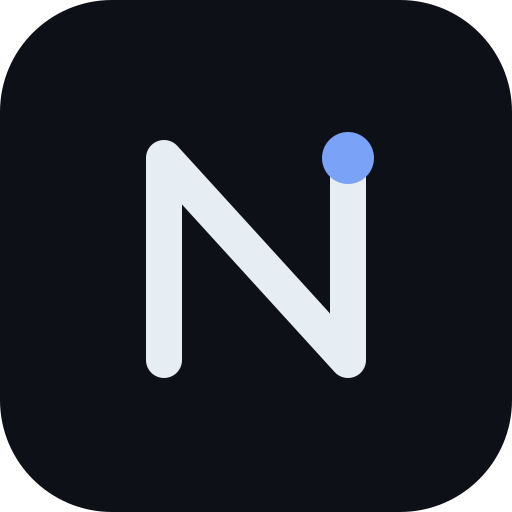

<p align="center">
  
</p>

# Nomen

自由的账号星系。

Nomen 是一个自由软件，用来给你的网站做账号系统：注册、登录、授权，它都管。你部署一份，名下的几个站点就能共用同一套账号，用户只记一个身份，不用在每个站点重新注册。

账号数据存在你自己的服务器上，不经过第三方。代码以 GPL-3.0-only 发布，可以自己部署、修改和分发。

技术栈是 PHP + MySQL / MariaDB / SQLite。

## 官方实例

- [nomenid.org](https://nomenid.org/)：官方站，带站内文档（`/w`）、下载和版本信息
- [id.caellab.com](https://id.caellab.com/)

两个实例跑的是同一份代码。

## 它是怎么工作的

Nomen 只管账号和身份，接入的站点各管各的业务。用户在站点 A 点登录，会跳到 Nomen 完成认证，再带着结果回到站点 A；去站点 B 时，已经登录过的身份可以直接用。

站点通过 OAuth 2.0 跟 Nomen 对接。标准的 OIDC 客户端读一下发现文档（`/.well-known/openid-configuration`）也能直接接入。

```
            Nomen
        （账号 / 身份）
             │
     ┌───────┼───────┐
   站点 A   站点 B   应用 C
```

站点用不用 Nomen、是否和别的站点共享账号，都由站点自己的管理者决定。

## 快速开始

1. 从[发布包](https://dl.caellab.com/file/nomen/)下载对应版本，解压到站点目录
2. 把 Web Root 指向 `public/`
3. 访问站点，按安装向导走完

也可以用命令行安装：`php bin/nomen install`。

Nginx 要加伪静态，服务器环境、定时任务和升级见下面的[部署](#部署)，其余细节在 [INSTALL.md](INSTALL.md)。

## 功能

**账号**

- 一个用户名可以绑最多 5 个邮箱，其中一个设为首选
- 五种登录方式：密码、邮箱验证码、临时密钥、Passkey（WebAuthn）、第三方登录
- 第三方登录支持 GitHub、Google、Microsoft、CaelLabID，也能接任意标准 OAuth 2.0 提供方
- 登录状态默认保持 30 天，每次使用顺延，最长 90 天。勾选「这是公共设备」后只在浏览器会话内有效
- 可以查看活跃设备，并单独踢掉某个会话
- 头像、语言、皮肤偏好，邮箱管理，改密码，注销账号

**安全**

- TOTP、恢复码、邮件验证码二步验证，以及 Passkey 无密码登录
- 每种登录方式都能单独开关，也可以给站点指定默认方式，插件还能注册新的登录方式
- 忘记凭据时走申诉流程：用户提交，管理员审核，通过后发一次性恢复链接
- 算术验证码、登录和接口限流、安全响应头

**对外提供身份**

- OAuth 2.0 授权码流程，PKCE 只接受 S256
- OpenID Connect：`/oidc/jwks.json`，id_token 带 nonce
- `/api/userinfo` 返回 `sub`、用户名、昵称和头像
- 开发者可以在开放平台上自己创建应用，配置回调地址和 scope
- 只读的站点 API：`/nomen-api`

**家庭与未成年人保护（可选）**

- 家长同意机制，需要填家长邮箱
- 家长可以重置孩子的密码、临时锁定账号，但看不到孩子的其他个人资料
- 按注册时选择的国家或地区，套用当地的同意年龄规则

**文档与搜索**

- 内置 Markdown 文档页，带目录、侧边栏、上一页/下一页，可导入文档，自动生成 sitemap
- 站内搜索默认查数据库，也可以换成 Meilisearch、OpenSearch 或 Elasticsearch
- 站内通知

**管理与运维**

- Vue 单页的管理后台：用户、应用、接入点、恢复工单、日志、插件
- 活动日志可按类型、执行者、目标筛选，能看字段前后对比，也能导出 CSV
- 站点健康检查：PHP 与扩展、数据库、目录权限、cron、邮件、缓存、更新、磁盘等，插件可以追加检查项
- 概览页的活动 / 新闻卡片可以上下排序，按管理员保存
- 定时任务只需要一条 cron。没配 cron 也不影响使用，只是定时任务不会按点跑
- 后台自动更新（可选）：默认只装补丁版本，更新前备份数据库和文件，失败自动回滚
- 缓存支持 Redis、文件、数据库，Redis 连不上会自动降级
- 首页的标题、按钮、模板都能在后台改，也可以直接指定某个站内页面当首页

**界面与扩展**

- 25 种界面语言，默认语言和是否允许用户切换由站长决定
- 皮肤可替换，包括纯 PHP 渲染的 `nomen-ssr`，用户可以在设置里选择启用哪个
- 功能以插件形式扩展
- 站点名、图标、版权、页脚、法律链接都能配置

部分功能默认关闭，可以在安装时选，也可以装完后改 `config/installed.php`。

---

## 部署

### 环境

| 组件 | 要求 |
| --- | --- |
| PHP | 8.1+ |
| 数据库 | MySQL 8+、MariaDB 10.6+ 或 SQLite 3.35+，三选一 |
| Composer | 只有从源码部署时才需要，发布包已经带了 `vendor/` |
| Redis | 可选，用于限流、缓存和多设备踢出会话 |
| Node.js | 18+，只有改前端时才需要 |

### Nginx

需要加伪静态规则：

```nginx
location / {
    try_files $uri $uri/ /index.php$is_args$args;
}
```

少了这条，一般就是只有首页能打开。服务器改不了伪静态的话，可以在安装向导里关掉「短地址」，改用 `index.php?page=…` 形式的地址。

数据库准备、目录权限、邮件、GeoIP 和排错，见 [INSTALL.md](INSTALL.md)。

### 定时任务

不配 cron 也能用，但 Pages 的 sitemap 预生成、插件的定时任务和自动更新检查都依赖它。加一行就行：

```cron
* * * * * php /path/to/nomen/bin/nomen schedule run >/dev/null 2>&1
```

宝塔面板在「计划任务 → Shell 脚本」里添加，周期选每分钟。

没有 cron 的话，sitemap 会在请求时现算，插件任务可以在后台手动运行。

### 升级

下载新版本覆盖旧文件，注意保留这几项：

- `config/installed.php`
- `.env`
- `data/`
- 上传目录

用 Git 部署的话，`git pull` 即可。更新完代码后执行：

```bash
php bin/nomen upgrade
php bin/nomen doctor
```

源码部署还要先跑一次 `composer install --no-dev`。`upgrade` 会执行核心和插件的数据库迁移，升级前的备份要求见[升级文档](INSTALL.md#升级)。

开了自动更新的站点，这些步骤后台会自己完成。

---

## 运维

`bin/nomen` 是命令行入口，不依赖 Web 环境。完整说明见 [docs/cli.md](docs/cli.md)，下面是常用的几个：

| 命令 | 作用 |
| --- | --- |
| `install` | 交互式安装：建库、导表、建管理员、写 `.env` |
| `upgrade` | 覆盖新版本文件之后运行：核心迁移 + 插件迁移 |
| `doctor` | 自检：扩展、目录可写、配置、数据库连接、待执行的迁移 |
| `backup [目录]` | 备份数据库，默认放在 `data/backups/` |
| `restore <文件>` | 从备份恢复，恢复前会先把当前库再备份一次 |
| `user:passwd <账号>` | 直接改密码，同时撤销该用户的令牌 |
| `auth:reset` | 登录方式全关、进不去后台时，用它恢复默认 |
| `schedule run` / `schedule list` | 执行到点的任务 / 查看任务和下次运行时间 |
| `update status` / `check` / `run` / `reset` | 自动更新：查状态、查新版、立即安装、清除失败记录 |

另外还有 `migrate`、`user:promote` / `user:demote`、`plugins ...` 等，见命令行文档。

数据库用 `php bin/nomen backup` 导出，文件直接备份站点目录，缓存和临时文件可以排除，完整流程见[备份与恢复](docs/integrate/backup-restore.md)。

健康检查在后台「站点健康」页，也可以请求 `GET /api/admin/site-health`。日志位置和探针地址见[日常运维](docs/ops/maintenance.md)与[日志与监控](docs/ops/logs.md)。

---

## 开发与扩展

加功能写插件，换界面写皮肤，都不用动核心代码。

### 插件

插件放在 `plugins/<slug>/`，用 `plugin.json` 描述。把目录放进去，再在 `config/plugins.php` 的 `enabled` 里加上名字就行。

发布包自带六个：

| 插件 | 默认启用 | 用途 |
| --- | --- | --- |
| [`pages`](https://github.com/NomenID/plugin-pages) | 是 | 站内文档 |
| [`open-platform`](https://github.com/NomenID/plugin-open-platform) | 是 | 开发者开放平台 |
| [`geoip`](https://github.com/NomenID/plugin-geoip) | 是 | 按 IP 查国家和地点（需要自己装 geoip2 和 mmdb） |
| [`totp-qr`](https://github.com/NomenID/plugin-totp-qr) | 是 | 在本地生成两步验证二维码 |
| [`search`](https://github.com/NomenID/plugin-search) | 否 | 站内搜索 |
| [`api-code`](https://github.com/NomenID/plugin-api-code) | 否 | 标识符绑定，通过 HTTP 接口发码登录 |

还有两个不随包分发，需要时自己装：`quick-central-login`（第一方应用免确认登录）和 `site-notice`（登录页提示条）。

开发文档：[plugins/README.md](plugins/README.md)

### 皮肤

皮肤放在 `skins/<slug>/`，用 `skin.json` 描述，可以覆盖任何模板，整个账号系统的外观都能换。官方皮肤单独发版，发布包里带了两个：

| 皮肤 | 说明 |
| --- | --- |
| [`nomen-2026`](https://github.com/NomenID/skin-nomen-2026) | 默认皮肤 |
| [`nomen-ssr`](https://github.com/NomenID/skin-nomen-ssr) | 纯 PHP 服务端渲染 |

开发文档：[skins/README.md](skins/README.md)

### 前端与测试

前端用 Vue 3 + Vite，源码在 `frontend/`，构建产物输出到 `public/assets/dist/`。从发布包部署的话不需要自己构建。

```bash
cd frontend
npm install
npm run build
```

测试不需要装 Composer 依赖，覆盖 TOTP、UNID、验证码、OIDC 等核心逻辑：

```bash
php tests/run.php
```

### 目录结构

| 路径 | 内容 |
| --- | --- |
| `src/` | 核心类：路由、会话、数据库、邮件、i18n、缓存、活动日志 |
| `controllers/` `templates/` | 请求处理和 PHP 模板 |
| `frontend/` | Vue + Vite 前端源码 |
| `public/` | Web 根目录 |
| `bin/nomen` | 命令行工具 |
| `database/` | 表结构、迁移、种子数据 |
| `config/` | 应用、品牌、邮件、开放平台等配置 |
| `locales/` | 核心的 25 种语言词条（插件和皮肤的词条在各自的 `i18n/` 里） |
| `plugins/` `skins/` | 插件和皮肤 |
| `docs/` | 随包文档 |
| `tests/` | 测试 |
| `code-scripts/` | 构建和文档生成脚本（不进发布包） |
| `scripts/` | 后台脚本：通知邮件队列、会话索引回填 |

---

## 文档

- [站内文档](https://nomenid.org/w)：安装、配置、扩展开发、运维
- [docs/README.md](docs/README.md)：随包文档的目录和阅读顺序
- [INSTALL.md](INSTALL.md)：安装、部署、升级
- [更新日志](https://nomenid.org/w/changelog)和 [GitHub Releases](https://github.com/NomenID/Nomen/releases)：每个版本改了什么，以及下载
- [SECURITY.md](SECURITY.md)：安全漏洞报告

## 反馈与参与

问题、建议、文档纠错，可以直接提 Issue，也可以通过[这个页面](https://caellab.org/who-we-are/contact/)联系我们。

如果是安全问题，请先看 [SECURITY.md](SECURITY.md)，不要公开发布。

---

## 许可证

| 范围 | 许可证 |
| --- | --- |
| 代码、模板、配置、语言词条（核心仓库和发布包） | [GPL-3.0-only](LICENSE) |
| 文档和帮助文本（`docs/`、`README.md`、`INSTALL.md` 等） | [CZS v1](LICENSES/CZS-v1.txt) |
| 官方站 [nomenid.org](https://nomenid.org/) 的页面内容（另有声明的除外） | [CC BY-SA 4.0](https://creativecommons.org/licenses/by-sa/4.0/) |

软件采用 GPL-3.0-only，仅限第 3 版，不含「或任何更新版本」。文档和帮助文本采用 CaelLab Zero Subject License, Version 1（CZS v1），官方站的站内文档（`/w`）也按它授权。

代码、插件、皮肤、文档和语言词条由 NomenID Team 和其他贡献者共同完成。版权行写的是版权持有人，不是完整的作者名单。

### 关于 NOTICE

[NOTICE](NOTICE) 不是许可，也不附加任何条件，只是一些建议：

- 保留版权声明、许可声明和作者署名。分发时 GPLv3 本来就要求，自己部署的话只是建议。
- 保留 `/special/version` 版本页，它列出了程序、PHP、数据库、依赖库、插件和皮肤的署名。插件和皮肤各自的许可证可能要求展示声明，这一点需要你自己核对。
- 没改过的 Nomen 可以继续叫 Nomen；改过代码的 fork 建议换个名字。名字和 logo 不在 GPLv3 的授权范围内，这只是请求，不是商标许可。
- 一旦分发，GPLv3 的全部要求重新生效：提供源码、保留版权和许可声明、标注修改。改名不算分发，也不能免除这些义务。

页面上的「Powered by Nomen」可以在 `config/brand.php` 里关掉，随你。

---

Copyright (C) 2025–2026 Yunyun (Wang Yaoze)